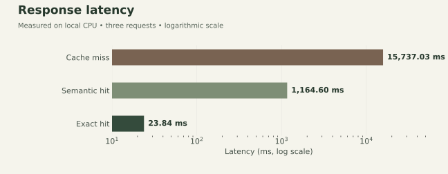
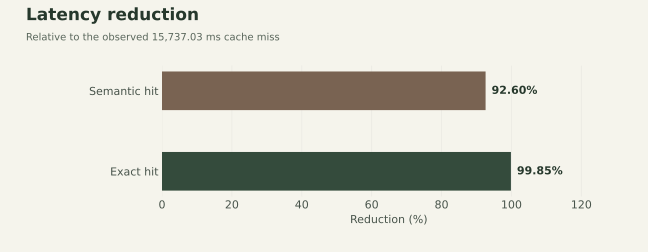
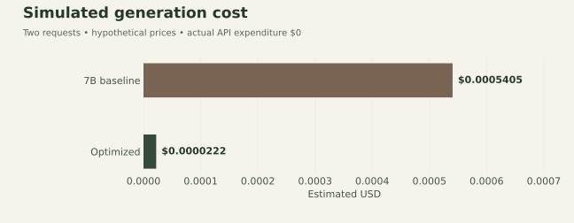
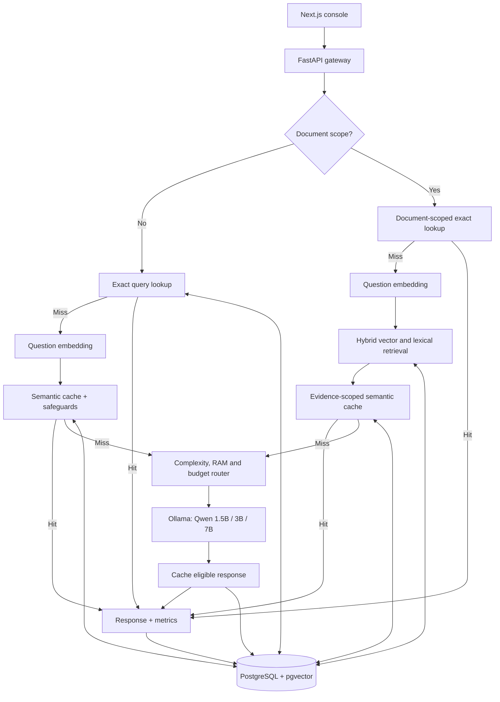

# LLMRoute

**Local LLM gateway for semantic caching, cost-aware routing and document intelligence.**

    

LLMRoute sits between AI applications and local language models. It avoids redundant generation by reusing eligible cached answers, routes new requests according to complexity, available memory and an estimated budget, and provides document-grounded question answering through retrieval-augmented generation (RAG). A minimal chalkboard-style console exposes routing decisions, source excerpts, latency and estimated costs.

> **Status:** v0.4.0 local development edition. No paid inference API required. Not a production-security release.

[Architecture](#architecture) · [Performance](#performance) · [Setup](#getting-started) · [API](#api-reference) · [Limitations](#limitations)

## Why LLMRoute?

Sending every request to the largest model wastes compute, increases latency and can raise inference expenditure. Exact-match caches help with repeated text but miss paraphrased questions. LLMRoute combines both caching approaches with a resource-aware model selection policy and persistent observability.

| Capability | Conventional direct inference | LLMRoute |
|---|---|---|
| Repeated identical questions | Generate again | SHA-256 exact lookup |
| Equivalent rephrased questions | Generate again | Vector similarity + heuristic checks |
| Model selection | Fixed model | Complexity, memory, mode and estimated budget |
| Document questions | Requires a retrieval layer | Integrated document-scoped hybrid RAG |
| Monitoring | Requires instrumentation | Persistent request and cost metrics |

This is a conceptual comparison against an unoptimized direct-inference baseline, not a comparison against other commercial gateways.

## Performance

### Observed response latency



| Request path | Measured latency | Speedup vs. inference | Latency reduction |
|---|---:|---:|---:|
| Cache miss / local generation | 15,737.03 ms | 1.00× | — |
| Semantic cache hit | 1,164.60 ms | 13.51× | 92.60% |
| Exact cache hit | 23.84 ms | 660.11× | 99.85% |

**Test workload:** `What is Python?`, the identical question, then `Can you explain what Python is?`. The semantic match scored 0.9222 cosine similarity; the threshold was 0.90. The baseline is the measured cache-miss gateway request, including embedding and cache work, not a separate uninstrumented model-only benchmark.



### Simulated inference expenditure



| Metric | Result |
|---|---:|
| Cost-tracked requests | 2 |
| Hypothetical 7B baseline | $0.0005405 |
| Hypothetical optimized generation | $0.0000222 |
| Estimated savings | $0.0005183 |
| Estimated reduction | 95.89% |
| Actual paid API expenditure | $0 |

The cost test used one economy-mode generation (36 input and 204 output tokens) and one exact-cache hit. The cache-hit counterfactual token count is estimated. Prices are illustrative, not current provider quotes. Electricity, hardware and embedding costs are excluded. The baseline does not establish equivalent answer quality across models.

### Experimental context

- ASUS VivoBook M1603QA, AMD Ryzen 5 5600H, 6 CPU cores, 16 GB installed RAM; Ollama CPU inference on Windows.
- Qwen2.5 1.5B for observed generation; all-MiniLM 22M for 384-dimensional embeddings; PostgreSQL 16 with pgvector.
- These are **preliminary development measurements from earlier iterations**, not a fresh v0.4.0 benchmark or a statistically representative evaluation. The latency experiment contains three requests, and the cost experiment contains two. Larger-model routing and end-to-end RAG quality require additional testing.

## Architecture



Document uploads are extracted, split into overlapping chunks and embedded in batches before storage. RAG exact lookup is scoped by document identity, file hashes and request settings; semantic reuse additionally requires matching retrieved evidence. Generated RAG answers are eligible for caching only when citation IDs are present and valid. A shared inference semaphore limits local resource pressure across chat, RAG and ingestion.

### Routing policy

| Mode | Selection policy |
|---|---|
| Economy | Prefer lightweight model |
| Balanced | Choose tier according to heuristic complexity |
| Performance | Prefer largest eligible model |

| Model | Role | Initial available RAM requirement | Simulated input / output per 1M tokens |
|---|---|---:|---:|
| Qwen2.5 1.5B | Lightweight | 2 GB | $0.05 / $0.10 |
| Qwen2.5 3B | Balanced | 3.5 GB | $0.15 / $0.30 |
| Qwen2.5 7B | Advanced | 6.5 GB | $0.50 / $1.00 |
| all-MiniLM 22M | Embeddings | — | Not priced |

The router falls back to a smaller eligible model or rejects a request when no model meets the configured constraints. RAM thresholds are policy defaults, not guaranteed runtime requirements. Budget checks are estimates, not strict billing ceilings.

## Technology stack

| Layer | Implementation |
|---|---|
| Console | Next.js, React, JavaScript, CSS |
| REST API | Python, FastAPI, Pydantic, HTTPX |
| Inference | Ollama, Qwen2.5 |
| Embeddings | all-MiniLM, 384 dimensions |
| Persistence | PostgreSQL 16, pgvector, Psycopg |
| Retrieval | Cosine similarity, PostgreSQL lexical matching |
| Document parsing | PyMuPDF |
| Infrastructure | Docker Compose, PowerShell |
| Tests | pytest |

## Getting started

### Prerequisites

Windows PowerShell, Python 3.12–3.14 with compatible package wheels, Node.js 20.9+ (22 LTS recommended), Docker Desktop and Ollama. Close other LLMRoute servers to free ports 8001 and 3005. Allow sufficient disk space for the models. Do not delete existing Docker volumes.

```powershell
git clone https://github.com/Lxzeroo/LLMRoute.git
cd LLMRoute
```

**Fresh installation** (isolated database on port 5434):

```powershell
powershell -ExecutionPolicy Bypass -File .\Setup.ps1
```

**Reuse the existing development database** (`llmroute-db`, port 5433) and already downloaded models:

```powershell
ollama list
powershell -ExecutionPolicy Bypass -File .\Setup.ps1 -ReuseExistingDb -SkipModels
```

The setup script initializes the schema, creates a virtual environment, installs dependencies, runs backend tests and checks database connectivity. Existing environment files are preserved. Do not switch database modes in the same directory without updating `backend/.env`. Fresh setup does not stop an old database container.

Start each service in a separate PowerShell terminal from the repository root:

```powershell
powershell -ExecutionPolicy Bypass -File .\Start-Backend.ps1
```

```powershell
powershell -ExecutionPolicy Bypass -File .\Start-Frontend.ps1
```

| Service | Address |
|---|---|
| Web console | http://127.0.0.1:3005 |
| Backend / Swagger | http://127.0.0.1:8001/docs |
| Database health | http://127.0.0.1:8001/health/db |
| Ollama health | http://127.0.0.1:8001/health/ollama |
| Ollama runtime | http://127.0.0.1:11434 |

## Using the console

- **Playground:** enter a question, choose a routing mode, optionally set an estimated USD budget, inspect the route or run inference.
- **Documents:** upload PDF, TXT or Markdown files and select the relevant document scope in the playground. Enable cache bypass when testing a fresh RAG response.
- **Analytics:** inspect request counts, exact and semantic hits, p50/p95 latency, model usage and simulated expenditure.

## API reference

| Method | Endpoint | Purpose |
|---|---|---|
| GET | `/health`, `/health/db`, `/health/ollama` | System and dependency health |
| POST | `/api/chat` | General inference with caching |
| POST | `/api/route` | Inspect routing without generation |
| GET | `/api/pricing` | Simulated model price table |
| GET | `/api/stats` | Cache statistics |
| POST | `/api/documents/upload` | Multipart document upload |
| GET | `/api/documents` | List indexed documents |
| GET, DELETE | `/api/documents/{document_id}` | Inspect or delete a document |
| POST | `/api/rag-v2/ask` | Document-grounded inference |
| GET | `/api/analytics/summary` | Request and latency metrics |
| GET | `/api/analytics/history` | Recent request records |
| GET | `/api/analytics/models` | Model usage |
| GET | `/api/analytics/costs` | Estimated expenditure and savings |

### Example: inference and cache reuse

```powershell
$body = @{ query = 'What is semantic caching?'; mode = 'economy' } | ConvertTo-Json
1..2 | ForEach-Object {
    Invoke-RestMethod -Uri 'http://127.0.0.1:8001/api/chat' -Method Post -ContentType 'application/json' -Body $body |
        Select-Object source, model, cache_hit, latency_ms
}
```

The second request should use the exact cache if the first answer is eligible and the cache scope is unchanged.

### Example: document question

```powershell
curl.exe -X POST 'http://127.0.0.1:8001/api/documents/upload' -F 'file=@sample.pdf'
```

Copy the returned document UUID into this request:

```powershell
$body = @{
    query = 'What is the main contribution of this document?'
    document_ids = @('REPLACE_WITH_DOCUMENT_UUID')
    mode = 'balanced'
    top_k = 3
    bypass_cache = $false
} | ConvertTo-Json
Invoke-RestMethod -Uri 'http://127.0.0.1:8001/api/rag-v2/ask' -Method Post -ContentType 'application/json' -Body $body
```

Responses may include source excerpts, page numbers and citation validation. An insufficient-context response is possible when retrieval cannot identify relevant evidence.

## Configuration

Copy or use the supplied `.env.example` files through the setup script. Never commit real `.env` files or credentials.

| Backend variable | Default / purpose |
|---|---|
| `DATABASE_URL` | Generated locally by setup |
| `OLLAMA_BASE_URL` | `http://127.0.0.1:11434` |
| `SMALL_MODEL`, `MEDIUM_MODEL`, `LARGE_MODEL` | Qwen2.5 1.5B, 3B, 7B |
| `EMBEDDING_MODEL` | `all-minilm:22m` |
| `CACHE_SIMILARITY_THRESHOLD` | `0.90` |
| `CACHE_TTL_SECONDS` | `86400` |
| `MAX_CONCURRENT_REQUESTS` | `1` |
| `MODEL_KEEP_ALIVE` | `0` |
| `CONTEXT_WINDOW` | `2048` |
| `MAX_OUTPUT_TOKENS` | `512` |
| `TEMPERATURE` | `0.2` |

## Repository structure

```text
LLMRoute/
├── backend/
│   ├── app/
│   │   ├── api/          # Chat, documents, RAG, analytics
│   │   ├── core/         # Configuration and database
│   │   ├── services/     # Cache, routing, inference, retrieval
│   │   └── main.py
│   ├── tests/
│   └── requirements.txt
├── frontend/
│   ├── app/              # Chalkboard console
│   ├── next.config.mjs
│   └── package.json
├── docs/assets/          # README performance graphs
├── schema.sql
├── docker-compose.yml
├── Setup.ps1
├── Start-Backend.ps1
├── Start-Frontend.ps1
└── README.md
```

## Verification and evaluation

```powershell
cd backend
.\.venv\Scripts\python.exe -m pytest tests -q
cd ..\frontend
npm.cmd run build
```

For a repeatable future evaluation, use a labeled workload of exact duplicates, paraphrases, negation and numeric changes, unrelated prompts and document-grounded questions. Compare cold/warm model conditions separately; measure p50/p95 end-to-end latency, cache precision and recall, answer correctness, abstention accuracy and model selection. Record failures as well as successes. The figures in this README should not be interpreted as guarantees.

## Limitations

- Local-only API has no authentication or tenant isolation; do not expose it publicly.
- Similarity and heuristic checks cannot guarantee semantic equivalence. Citation-ID validation does not prove factual grounding.
- RAG may return incorrect answers or abstain incorrectly; scanned PDFs requiring OCR are unsupported.
- Local inference still consumes electricity, memory and compute. Simulated cost is not real billing, and budget estimates are not hard limits.
- Historical metrics omit failures and some abstentions; older cache namespaces may not be reused. Raw queries and extracted document content are stored in PostgreSQL.
- Hybrid ranking scans selected document chunks; index-assisted retrieval at scale, comprehensive benchmarking and production hardening remain future work.

## Roadmap

- [x] Persistent exact and semantic caching
- [x] Memory-aware and estimated-budget model routing
- [x] Document ingestion and hybrid RAG
- [x] Local analytics and chalkboard console
- [ ] Larger labeled benchmark suite and quality-aware routing
- [ ] Improved grounding, citation fidelity and retrieval scaling
- [ ] Authentication, tenant isolation and production observability

---

Maintained by [Lxzeroo](https://github.com/Lxzeroo). License: see repository license if one is added.
